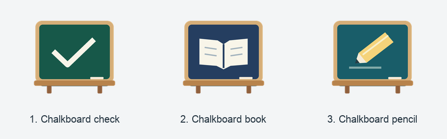

# Classroom Publisher

A Python desktop application that publishes a student's Google Classroom **Stream post** using attachments that already exist in that child's Google Drive. Designed for three children's accounts, with a separate saved Chrome login for each child.

**Status: experimental implementation, awaiting a real school-account test.** The application includes automatic browser navigation, Drive selection, post verification, dialogs, and a Windows installer/context-menu action. Automated tests use a local simulated Classroom/Drive website. Google's real page structure and login restrictions have not been verified for your school. The configurable page selectors will likely need adjustment during the first live test. Do not treat this release as a proven unattended publisher.

## How it works

1. Choose a publication folder, either in the app or with Explorer's **Publish to Classroom** action.
2. Python matches its class root to the configured child and Classroom class.
3. It validates the folder before opening Chrome, builds the post text, and shows an editable review dialog.
4. Playwright opens that child's dedicated saved browser profile. Your normal Chrome account is irrelevant; no browser needs to remain open between publications.
5. The app checks the signed-in email and class URL, opens the Stream composer, and fills the reviewed text.
6. It opens **Google Drive** in the attachment picker, follows the configured folder path, and selects the intended files in natural filename order and attaches them together. It checks picker breadcrumbs and file IDs against the links added to the draft.
7. After the draft checks pass, the app clicks Post once automatically; there is no additional approval dialog.
8. It finds a new stable Stream item ID with the matching text and attachment IDs, reloads the page, and verifies the same item again.
9. Only then does it create `classroom-published.txt` and close its Chrome window.

Python runs the application, file validation, dialogs, and publication tracking. Playwright is the Python library that controls Chrome. The program has **no attachment-upload code**, does not read image/PDF contents, and does not use Google REST APIs or OAuth credentials. It never selects Upload or a permission prompt's Copy option. Google Drive for desktop must finish syncing the original files beforehand.

Only one app operation runs at a time per OS user. The other children's browsers stay closed. Google may occasionally require signing in again. Passwords and verification codes are entered directly into Google; the application does not collect them. Saved browser profiles contain sensitive login cookies and must stay local and private.

## Windows 11 installation

### 1. Install the prerequisites

- **Python 3.12 or newer** from [python.org for Windows](https://www.python.org/downloads/windows/), including Tcl/Tk and the Python launcher (`py`). The code also supports Python 3.9–3.11; 3.12+ is recommended for a new installation.
- **Google Chrome** from [Google](https://www.google.com/chrome/).
- **Google Drive for desktop**, with all three children's accounts already connected and their class folders synced.

Use your normal Windows account. Administrator access is not needed for Classroom Publisher itself. Internet access is needed to download Python dependencies and to use Classroom.

### 2. Extract and install

Extract `classroom-publisher.zip` to a normal local folder, such as Downloads. Do not run it directly inside the ZIP.

Open PowerShell in the extracted `classroom-publisher` directory and run:

```powershell
powershell.exe -NoProfile -ExecutionPolicy Bypass -File .\install-windows.ps1
```

The execution-policy option applies to that one installer process; it does not permanently change your system's policy. If Windows organization policy prevents script execution, it still takes precedence.

Before updating, close all Classroom Publisher windows so an already-running process cannot keep using old code. From a Git clone, run `git pull`, then the installer above. The installer reinstalls directly from that checkout and compares the installed Python files and icons against it. Look for **Verified installed application:** before the completion message. Configuration and saved logins are preserved. If you still see the old error “Stream composer is unavailable; check student posting permissions”, an old application process or installation is running; the updated error begins “Cannot locate the Stream post box”.

The installer:

- Copies the application to `%LOCALAPPDATA%\ClassroomPublisher\app`.
- Creates an isolated Python environment and installs the application and Playwright.
- Creates `%LOCALAPPDATA%\ClassroomPublisher\config.json` if it does not exist; existing configuration is preserved.
- Adds a **Classroom Publisher** desktop shortcut.
- Adds **Publish to Classroom** to the current user's Explorer folder/context menu.
- Opens the configuration in Notepad.

Chrome is controlled from its existing installation; no additional Playwright browser download is needed. The installer does not sign into Google or publish anything. Its Windows-specific execution has not been tested on a Windows 11 machine yet.

### 3. Configure the three accounts and classes

In the configuration, replace the example email addresses, local folder paths, and class URLs. A class entry looks like:

```json
{
  "child": "child1",
  "root": "G:/My Drive/Homework/Class 4",
  "drive_path": ["Homework", "Class 4"],
  "url": "https://classroom.google.com/c/YOUR_REAL_CLASS_ID"
}
```

`child` references a key under `children`. `root` is the class root on the computer. `drive_path` is the exact sequence of folder names inside **My Drive** leading to that same class root. Do not include `My Drive` itself or any folders below the class root: the app appends the selected folder’s entire path relative to that root. These are display names, not Drive IDs. A local Windows drive letter alone cannot locate an online Drive folder.

Use forward slashes in JSON Windows paths, as shown, or double every backslash. Drive letters in the example are illustrative; use the real synced locations. For streamed Drive locations, use the paths visible in Explorer. If you choose another account's path or a different remote folder, the local and online files will not correspond; check the mapping during setup.

You can configure multiple classes per child. Every class entry needs a unique local root. Each child's email must be unique. The same subject name can occur beneath different class roots.

Default profiles are created automatically at:

```text
%LOCALAPPDATA%\ClassroomPublisher\profiles\child1
%LOCALAPPDATA%\ClassroomPublisher\profiles\child2
%LOCALAPPDATA%\ClassroomPublisher\profiles\child3
```

An optional `profile` field under a child overrides its location. Never point it at your normal Chrome User Data folder, another child's profile, OneDrive, or Google Drive. Separate profiles are essential for account isolation.

### 4. Save each child's login once

Open the desktop shortcut. Choose `child1` and click **Sign in / inspect class**. A dedicated Chrome window opens. Sign in as that child, complete any Google verification, and open the configured class Stream. Then click OK in the application's sign-in dialog. The app checks the account and saves the session when Chrome closes.

Repeat for the other two children. There is no need to keep those windows open. If Google rejects sign-in in the automated browser, stop and record the error; this app does not bypass login protections.

If sign-in succeeds but account verification fails, this can be a page-detection problem rather than an authentication problem. The app recognizes the Google account-menu link independently of its translated label and reads the active email from the control's label, title, or tooltip. It waits for the control to load and still refuses ambiguous controls or a different email. It never accepts an email merely because it appears somewhere on the class page. After updating, remove any old English-only `ui.account` override from your configuration to use the improved default. You do not need to delete the child's saved profile. If verification still fails, inspect the actual account control before changing the selector; do not disable the email check.

**Do the first two-file test before relying on automatic publishing.** A teacher must allow student Stream posts. The current page selectors assume English labels; your account's interface may use different labels or markup. See “First live test and UI adaptation” below.

## Preparing a publication folder

```text
G:/My Drive/Homework/Class 4/    configured root
  Matemātika/                  subject
    2026.10.15/                publication date
      2.jpg
      10.jpg
      description.txt          optional UTF-8 text
```

Folder names and depth are unrestricted. Select the configured root itself or any folder beneath it; no date format or subject/date hierarchy is required. For example, `Homework`, `Matemātika/Week 3`, and `Projects/Term 1/Finished exercises` are all accepted. The same relative path is followed in the online Drive picker. Only files directly in the selected folder are published; nested folders are not included.

The selection must belong to exactly one configured root. Unrelated locations, symlinks that resolve outside the configured roots, and ambiguous overlapping roots are rejected. The app still relies on your configured roots being synced to the matching child’s Drive.

Supported attachments: **JPG, JPEG, PNG, GIF, WEBP, PDF**, ignoring filename-extension case. Files are direct children only. Subfolders are not recursively published. Supported-extension directories, symlink attachments, empty attachments, missing attachments, are rejected. Other files, including `description.txt`, are not attachments.

The default first post line joins the folder names below the class root with ` — `. For the example above it is:

```text
Matemātika — 2026.10.15
```

The contents of `description.txt`, if present, follow after a blank line. You can edit the entire post, including its first line, before preparing the draft. If the selected folder is the class root itself, the default title is that root’s name. An empty post is rejected.

Filenames use case-insensitive natural order: `2.jpg` before `10.jpg`. A deterministic filename tiebreaker resolves equivalent natural keys. If there are **more than 20 supported files**, the entire operation is blocked before Chrome opens. A scrollable dialog lists the excess names. No files are published, and no success/pending marker is created by that validation failure. Move the excess files to another publication folder and retry.

## Everyday use on Windows 11

1. Wait for Google Drive for desktop to sync the folder. Confirm the files are visible in that child's web Drive during initial setup.
2. Right-click the publication folder → **Show more options** → **Publish to Classroom**. Alternatively, open the desktop shortcut and choose **Publish a folder**.
3. Review/edit the text and click **Prepare in Classroom**.
4. Let the automation select the files. Do not operate the automated Chrome window while it is preparing the draft.
5. Review the completed draft and approve the final dialog. Do not click Post manually in Chrome.
6. A success dialog appears only after the persisted post has been verified and the marker saved.

The menu also works on empty background space inside the publication folder. The current installer adds the action to the classic **Show more options** menu. Moving it into Windows 11’s main menu requires a native `IExplorerCommand` COM extension registered with app identity (MSIX or a sparse package). A plain registry verb cannot be promoted there by changing its position or icon. This release does not build/register that native extension or change Explorer’s global menu behavior. See [Microsoft’s extension requirements](https://learn.microsoft.com/windows/apps/desktop/modernize/integrate-packaged-app-with-file-explorer).

### Icons

The Explorer action now uses Google’s official Classroom integration icon. The desktop shortcut and application windows use an original chalkboard icon instead of the Python icon. Google’s [branding guidance](https://developers.google.com/workspace/classroom/brand) provides the integration icon but distinguishes it from an independent application’s own logo. Source attribution is bundled in `src/classroom_publisher/assets/ATTRIBUTION.md`.



The default is **chalkboard-book** (option 2). To choose another desktop shortcut icon, rerun the installer from the updated checkout with one of these options:

```powershell
powershell.exe -NoProfile -ExecutionPolicy Bypass -File .\install-windows.ps1 -ShortcutIcon chalkboard-check
powershell.exe -NoProfile -ExecutionPolicy Bypass -File .\install-windows.ps1 -ShortcutIcon chalkboard-pencil
```

Omit `-ShortcutIcon` or set it to `chalkboard-book` to restore the default. This option changes the desktop shortcut; app windows retain the default chalkboard-book icon and the Explorer action retains the Classroom icon. Rerunning the installer updates both the menu registration and shortcut while preserving configuration and saved logins. Windows may cache an old shortcut image until Explorer refreshes. Actual Windows rendering still needs a Windows 11 check.

If the desktop shortcut shows a blank page, update your checkout/download and run this from its folder:

```powershell
powershell.exe -NoProfile -ExecutionPolicy Bypass -File .\scripts\repair-shortcut.ps1
```

This recreates the shortcut with the selected chalkboard-book icon (option 2), using an unquoted icon location and a separate local icon file to avoid the old cached path. It preserves configuration and saved logins and does not reinstall dependencies. Press F5 on the desktop if the old image remains. The repair script also accepts `-ShortcutIcon` with the options above.

The review window shows the child, class URL, remote folder path, and ordered attachment names. Wrong-account, missing-file, ambiguous-file, changed-file, and uncertain-post checks stop the process. The application does not delete a potentially faulty post automatically.

## Success markers and recovery

There is **no database**. `classroom-published.txt` is the sole success marker. It contains:

- Attempt-start and confirmation timestamps with timezone.
- Child and class.
- The complete reviewed post text.
- Attachment count and naturally ordered filenames.
- Verified Drive IDs when automatically captured.
- Post URL if a valid link can be retrieved.
- Whether confirmation came from browser verification or manual recovery.

The confirmation timestamp is local confirmation time, not a claimed server publication time. Rendered whitespace is normalized for browser comparison; the marker retains the exact reviewed text. A folder with a success marker is never automatically published again, even if its files later change.

Before opening the publication browser, the app creates `.classroom-pending.json`. This is an attempt record, **not** a success marker. It prevents duplicate publication after an interrupted or ambiguous operation and snapshots the reviewed content. It records preparing/draft-ready/posting/verifying stages and the selected Drive IDs where available.

If a timeout occurs after clicking Post, Google might still have accepted the post. The application **never retries Post automatically**. Cancellation after the browser opens, login problems, and pre-post errors also conservatively leave the pending attempt in place.

To recover:

1. Open the app and use **Sign in / inspect class** for the correct child. Inspect the Stream, compare the full text and attachments, and reload. Close any old composer.
2. Choose **Publish to Classroom** on the same folder again. The recovery dialog shows the saved status and original post text. You can also open **Recover an uncertain attempt** manually.
3. Click **Retry publishing** only after checking that no post exists and closing old drafts. There are no typed confirmation words or extra confirmation popup.
4. Edit the saved title and description directly in the recovery dialog before clicking Retry publishing. When opened from Publish, retry goes straight to preparing the browser draft without a second preparation dialog. Initial publications still show the normal preparation editor. There is no second approval popup: clicking Publish to Classroom or Retry publishing authorizes posting once the draft checks pass.
5. Click **Cancel publication** if the post exists, you are unsure, or you want to stop. Cancellation preserves the unresolved record and does not create a success marker. Closing the window has the same effect.

Do not delete the marker or pending file as a shortcut. A local OS lock prevents concurrent app operations on the same computer. Drive sync is not a distributed lock: **use one publishing computer at a time**. The marker and attempt record sync along with the publication folder.

## First live test and UI adaptation

The browser adapter is implemented and tested against a simulated UI, **not against a signed-in Google Classroom account**. Real Google markup is not a stable public interface. In particular, composer containers, picker breadcrumbs/rows/file-ID attributes, and Stream item IDs need live inspection. The application stops on missing/ambiguous elements rather than guessing or treating a disappeared dialog as success.

Actual publishing and sign-in use a visible Chrome window, not headless mode. The editable publication dialog authorizes posting after the automated checks. Only the simulated browser tests run headless.

Start with exactly two already-synced images in a new folder. First use **Validate a folder**, then run publication while watching the browser. Record the result in `LIVE-TEST.md`.

Page settings are listed in `ui.reference.json` and implemented in `browser.py`'s `DEFAULT_UI`. Override only necessary entries under `ui` in `config.json`. A locator can be a CSS selector string, `{"role": "button", "name": "Exact visible label"}`, or `{"text": "Exact visible text"}`. English button/tab names may need translation. Role locators can use `names` for an explicit list of exact accessible names. The `picker_my_drive` entry must retain a `role` and either `name` or `names`; the matched name identifies the first breadcrumb.

An example label override is:

```json
"ui": {
  "post": {"role": "button", "name": "THE_ACTUAL_POST_LABEL"},
  "picker_select": {"role": "button", "name": "THE_ACTUAL_INSERT_LABEL"}
}
```

Do not copy placeholder labels literally. Use observed labels from your account. For developer inspection, run the `inspect` command below; Playwright Inspector pauses the browser so you can inspect the real composer and picker without automating publication. Resume/close it to end inspection. Do not publish from Inspector.

If opening the Stream composer reports zero matches, that alone does not prove student posting is disabled. The default recognizes “Share something with your class”, “Announce something to your class”, “New announcement”, and “Jauns paziņojums”, with optional ellipsis. For another language, set `ui.open_composer` to `{"text": "the exact prompt shown on your Stream"}`. Remove an outdated `ui.open_composer` override to use the updated default. Locators also support `{"text_regex": "^an anchored expression$"}`; ambiguous visible matches still stop publication. After a failed attempt, use the recovery steps above before retrying.

Required observations before calling this ready for everyday use:

- Correct child's login persists across browser restarts.
- Teacher permits student Stream posts.
- Online folder breadcrumbs correspond to the configured local folder.
- Picker exposes a stable Drive file ID that agrees with the resulting attachment link.
- Exact filenames and Drive IDs match in draft and persisted post; displayed order may differ.
- Stream items expose stable IDs and full post text after reload.
- No Upload or Copy path is used.

Current limitations: no picker scrolling/pagination, collapsed breadcrumb expansion, account-switching recovery, or permission-dialog handling is implemented. Items must be present in the picker's rendered results. Avoid duplicate filenames/folder names within the same Drive parent; the app rejects visible ambiguity but cannot prove the absence of offscreen duplicates in a virtualized picker. Local size/mtime checks detect changes during preparation but do not prove byte equality with the online file. Old posts outside the loaded Stream cannot be searched exhaustively; durable marker/pending files are the primary duplicate protection. If the school UI cannot expose the evidence required by these checks, more adapter work is needed before publishing automatically.

## Command-line usage

On Windows, the installed Python is:

```powershell
$python = "$env:LOCALAPPDATA\ClassroomPublisher\app\.venv\Scripts\python.exe"
& $python -m classroom_publisher.cli gui
& $python -m classroom_publisher.cli login child1
& $python -m classroom_publisher.cli validate "G:/My Drive/Homework/Class 4/Matemātika/2026.10.15"
& $python -m classroom_publisher.cli publish "G:/My Drive/Homework/Class 4/Matemātika/2026.10.15"
& $python -m classroom_publisher.cli reconcile "G:/My Drive/Homework/Class 4/Matemātika/2026.10.15"
& $python -m classroom_publisher.cli inspect child1
```

Pass `--config "C:/path/config.json"` to use a different configuration. GUI errors include excess filenames and recovery guidance. CLI validation prints to the terminal and does not launch Chrome. `inspect` is a developer tool, not part of daily use.

## macOS installation

Install Python with Tkinter and Google Chrome, then from the extracted project folder:

```sh
python3 -m venv .venv
.venv/bin/python -m pip install --upgrade pip
.venv/bin/python -m pip install -e .
mkdir -p "$HOME/Library/Application Support/ClassroomPublisher"
cp -n config.example.json "$HOME/Library/Application Support/ClassroomPublisher/config.json"
.venv/bin/python -m classroom_publisher.cli gui
```

Edit the configuration for the actual macOS Google Drive paths. Profiles are stored in `~/Library/Application Support/ClassroomPublisher/profiles/`. The same dialogs and Python/Playwright code are used on both platforms.

Optional Finder integration: create an Automator **Quick Action** receiving folders in Finder, add **Run Shell Script**, choose **Pass input: as arguments**, and run the installed environment's absolute Python path:

```sh
for folder in "$@"; do
  "/ABSOLUTE/PATH/classroom-publisher/.venv/bin/python" -m classroom_publisher.cli publish "$folder" --gui
done
```

Save it as **Publish to Classroom**. This optional Quick Action is not automatically installed or verified.

## Updates and uninstalling

To update on Windows, close the app and its dedicated Chrome windows, extract the new version, and rerun its installer. It preserves configuration and saved profiles.

To remove the Explorer action:

```powershell
& "$env:LOCALAPPDATA\ClassroomPublisher\app\.venv\Scripts\python.exe" -m classroom_publisher.cli context-menu remove
```

Then delete the desktop shortcut and `%LOCALAPPDATA%\ClassroomPublisher\app`. To remove the saved logins as well, delete the `profiles` directory after closing its Chrome windows. Deleting profiles does not delete Google accounts or Drive files. Publication marker files remain in their folders.

## Developer verification

Install the project into a virtual environment first. Core tests:

```sh
python -m unittest discover -s tests -v
```

Full local browser-fixture tests (installed Chrome required):

```powershell
$env:CLASSROOM_BROWSER_TESTS = '1'
python -m unittest discover -s tests -v
Remove-Item Env:CLASSROOM_BROWSER_TESTS
```

macOS/Linux equivalent:

```sh
CLASSROOM_BROWSER_TESTS=1 python -m unittest discover -s tests -v
```

All fixture browser requests are intercepted. These tests exercise the full two-file selection → one Post click → reload → success marker flow, plus wrong account, missing/duplicate files, accepted display reordering, changed local files, existing post, cancellation, missing persisted post, wrong persisted Drive ID, and a network failure after acceptance. They do not access Google or publish real content. Windows installer/Explorer behavior and the Tk dialogs still require a Windows 11 smoke test.

References: [Google's student Stream workflow](https://support.google.com/edu/classroom/answer/6020274?co=GENIE.Platform%3DDesktop&hl=en), [Playwright persistent browser contexts](https://playwright.dev/python/docs/api/class-browsertype#browser-type-launch-persistent-context).


### Observed Latvian controls and HTML inspection

The user observed a direct Drive attachment button with accessible name `Pievienot Google diska failu`, the publish label `Izlikt`, and the Drive tab `Mans disks`. These labels are supported. A unique visible direct Drive button opens the picker without the older Add → Google Drive menu sequence. The older flow remains supported when the direct button is absent. Existing `ui.post` or `ui.picker_my_drive` overrides take precedence; remove outdated overrides to use the defaults.

The picker path is the configured `drive_path` plus the publication folder's path relative to the configured local class root. For example, a Drive root of `["5.klase"]` and a local publication folder `L_Lat.v/Finished work` select `Mans disks → 5.klase → L_Lat.v → Finished work`. Folder names are not hardcoded. Only the validated files directly inside that publication folder are selected, in natural filename order.

The initial View Source exports did not contain runtime dialogs. Later iframe DOM captures show folder tiles as `role="option"` with `data-target="doc"` and `data-id`, no root breadcrumb, and nested breadcrumb buttons with `data-id` and `data-tooltiptext`. The breadcrumb starts with English `My Drive` even under the Latvian `Mans disks` tab. The adapter supports this observed structure and compares each opened folder ID with its selected tile ID. Tests reproduce that structure with synthetic files and IDs. A subsequent selected-file capture shows a button displaying `Pievienot` with a count-bearing accessible name (`Pievienot 3 vienumi`). Confirmation matches the exact visible button text inside the picker, rather than assuming the accessible name equals the caption. The user confirmed live folder traversal and a successful post. Automatic persisted-post verification is being adapted to the captured page; its next live check remains outstanding. Existing custom picker selectors override updated defaults.

To capture usable markup, open the popup, press F12, and use the **Elements** tab (not View Source). Use the element selector to select a control, move up to the enclosing dialog, then right-click → Copy → Copy outerHTML. For the Drive picker, select an element inside the picker iframe and copy its enclosing dialog or document element from inside that frame. Copying only the outer iframe does not capture its contents. Preserve role, aria-label, and structural attributes; redact personal text and identifiers. Keep these captures outside the repository.


The post review dialog defaults to 680×440 with a short description area and a four-row, scrollable attachment list. Its buttons have a separate layout row. Actual Windows display scaling still needs a visual check.

An exact legacy `ui.picker_select` value of `{"role": "button", "name": "Insert"}` is migrated in memory to the current bilingual confirmation selector. Other custom selectors are preserved. If confirmation cannot be located, the error includes the effective selector and visible picker button text/accessibility labels; share that diagnostic instead of changing labels by trial and error.


### Batch attachments and recovered descriptions

Publication opens the Drive picker once, navigates to the publication folder once, and selects the intended filenames in natural order using additive selection. It waits for each additive selection to appear, checks that earlier selections remain selected, and rechecks the complete Drive ID set immediately before confirming. When the confirmation button exposes a selected-item count, it must agree too. The picker confirmation is clicked once. It never uses Select All, which could include metadata files. The resulting draft must have exactly the expected filenames and Drive IDs before Post is allowed. Displayed order is ignored; natural sorting is retained for selection and metadata.

After the operator checks that no post exists, closes old composers, and clicks **Retry publishing**, the same `.classroom-pending.json` stores the reviewed text with stage `retry_ready`. A new attempt resets its stage to `preparing`; any other unresolved stage blocks automatic retries. No separate draft file is created. Existing `.classroom-draft.json` files are migrated automatically; an existing pending record takes precedence. All attachments are freshly validated. JSON files are never supported attachments. `classroom-published.txt` remains the only success marker.


Publication now proceeds automatically after the editable dialog and successful draft checks, without an extra approval popup. The Post click is still attempted only once. Published-page verification recognizes outermost Stream items, split title/description spans, cover-image accessibility labels, and duplicate thumbnail/title links within one attachment card. It still checks complete text and exact Drive identities after a reload.

For an existing successful post with an uncertain saved outcome, choose **Verify existing post** in recovery. This uses the saved text, selected Drive IDs, and pre-post baseline to find the same new post across two page loads. It never clicks Post or adds attachments. If verification succeeds it writes the success marker; otherwise the attempt remains unresolved. Edits in the recovery text box do not change the evidence used for verifying the original post.
